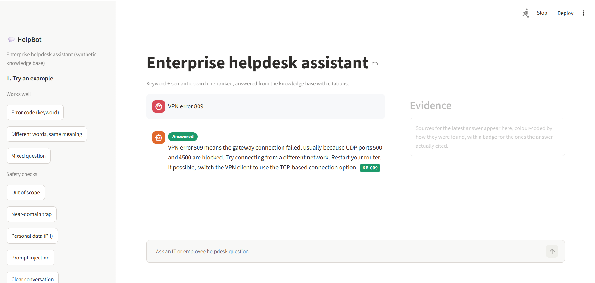
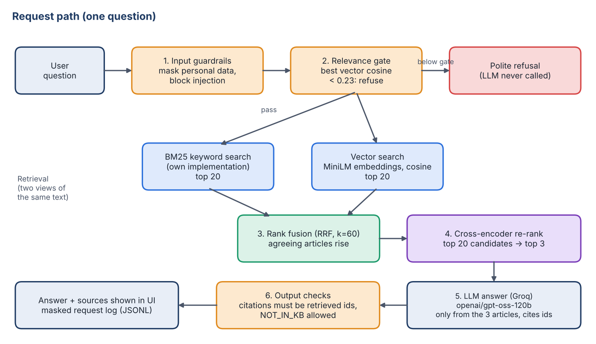
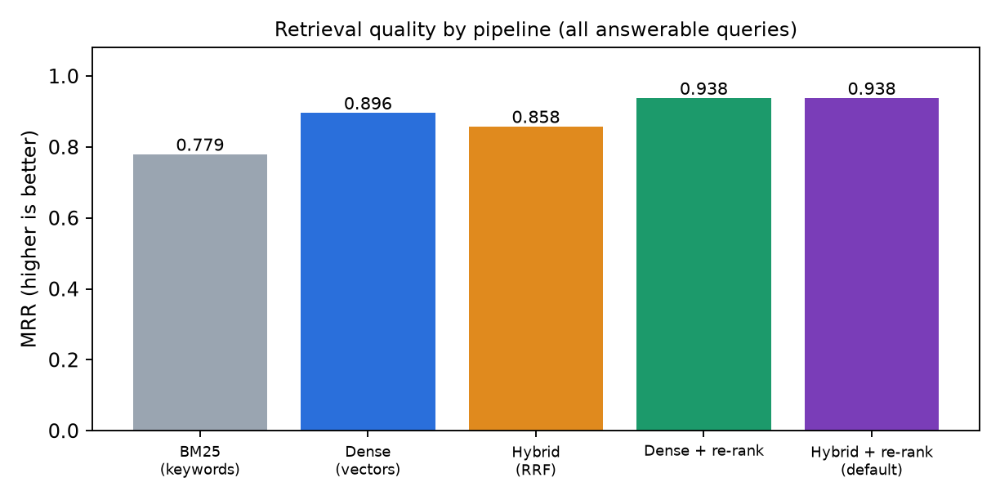
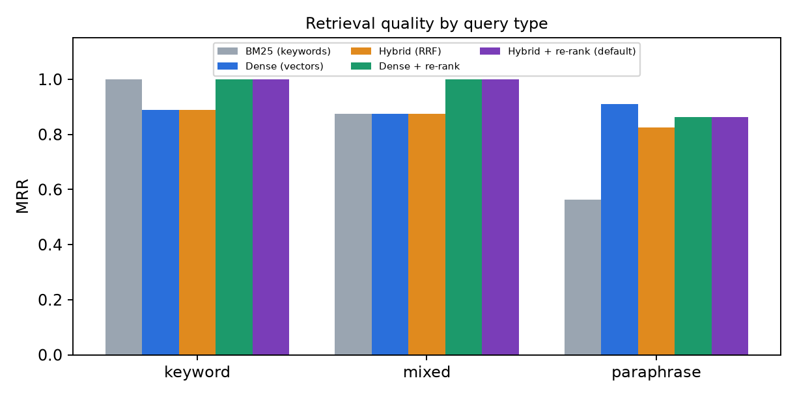
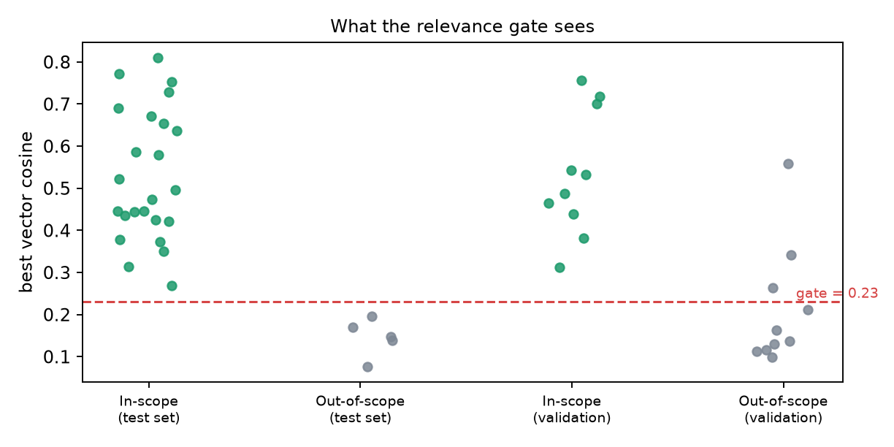

# Helpdesk Hybrid Search Assistant

A configurable retrieval-augmented helpdesk assistant that combines **keyword search (BM25)** and **semantic vector search**, fuses them with **Reciprocal Rank Fusion**, re-orders the best candidates with a **cross-encoder**, and answers with an LLM **only from the retrieved articles, with citations**. Three layers of **guardrails** keep it from answering what it should not.

Built as a coursework project (M.Tech AI/ML, Conversational AI). The knowledge base is **synthetic**; no company data is used.



## What it demonstrates

- **Hybrid retrieval, measured honestly.** Five pipelines (BM25, dense, hybrid, dense + re-rank, hybrid + re-rank) compared on labelled queries with hit@1, recall@3 and MRR.
- **Grounded answers.** The LLM sees only the top 3 re-ranked articles, must cite them, and may answer `NOT_IN_KB`; invented citations are removed.
- **Layered guardrails.** Personal-data masking and injection check, a relevance gate that refuses unrelated questions without calling the LLM, and output validation.
- **Enterprise-style engineering.** One YAML config, masked request logs, fallback model then extractive fallback, automated tests, a Streamlit UI with a colour-coded evidence panel.

## Architecture



`question -> input guardrails -> relevance gate -> BM25 + vector search -> RRF fusion -> cross-encoder re-rank -> LLM (Groq) -> output checks -> answer + sources + masked log line`

## Results (retrieval)

24 answerable test queries (keyword, paraphrase and mixed). These numbers are deterministic; the LLM end-to-end results can vary slightly between runs and are in `results/`.

| Pipeline | hit@1 | recall@3 | MRR |
|---|---|---|---|
| BM25 (keywords) | 0.750 | 0.792 | 0.779 |
| Dense (vectors) | 0.833 | 0.958 | 0.896 |
| Hybrid (RRF) | 0.792 | 0.917 | 0.858 |
| Dense + re-rank | 0.875 | 0.979 | 0.938 |
| **Hybrid + re-rank (default)** | **0.875** | **0.979** | **0.938** |

What the experiments showed, including the parts that did not go as expected:

- Keyword and semantic search fail in opposite ways: BM25 is perfect on exact error codes and weak on paraphrases; vectors are the reverse.
- **Plain RRF fusion did not beat the vector search alone** on this small, clean corpus. RRF rewards agreement, so a wrong article both retrievers rank moderately can outscore the right one that only one retriever ranks first.
- The re-ranker raised MRR overall but slightly lowered it on paraphrase queries (it was trained on web search, not helpdesk chat).
- The default pipeline (hybrid + re-rank) ties dense + re-rank. It is chosen as a design judgment (keyword search stays as a safety net for exact terms), not because the data proves it better.




## Guardrails

| Layer | What it does |
|---|---|
| Input | Masks emails, phone numbers, Luhn-valid card numbers, PAN and Aadhaar-style numbers before the LLM and the logs; blocks obvious prompt-injection phrases |
| Relevance gate | If the best article's cosine is below `guardrails.min_dense_cosine`, refuse and never call the LLM |
| Output | The prompt allows only the supplied articles and `NOT_IN_KB`; every citation must be a retrieved article id |

A similarity threshold cannot catch questions that merely sound like helpdesk questions (for example a personal Gmail password). The grounded prompt is the second layer for those. These guardrails are a first line of defence, not a complete one.



## Quick start

Python 3.10+.

```bash
python -m venv .venv
# Windows PowerShell:  .venv\Scripts\activate        macOS/Linux:  source .venv/bin/activate
pip install -r requirements.txt
cp .env.example .env        # Windows: copy .env.example .env   then add your Groq API key
python run_stage6.py --ask "VPN error 809"
streamlit run app.py
```

The first run downloads two small models (about 90 MB and 80 MB). Without a Groq key, run with `--no-llm` for extractive answers. See [docs/DEMO.md](docs/DEMO.md) for a 2-minute demo path.

## Reproduce the experiments

Each stage has its own script that prints and saves its results:

| Script | What it does |
|---|---|
| `run_stage1.py` | Load and validate the corpus and test queries |
| `run_stage2.py` | TF-IDF vs BM25 (`--sweep` for k1 / b) |
| `run_stage3.py` | Add the vector retriever |
| `run_stage4.py` | RRF fusion (`--sweep` for the RRF constant) |
| `run_stage5.py` | Add re-ranking; full evaluation of all five pipelines and charts |
| `run_stage6.py` | End-to-end assistant: `--calibrate`, `--ask "..."`, or the full evaluation |
| `build_report.py` | Optional: builds a PDF report from the results |

## Configuration

Everything tunable lives in `config/config.yaml`: BM25 `k1` / `b`, RRF constant and weights, model names, candidate pool and top-n, the gate threshold, PII mode, the LLM and fallback model, and the domain name and messages. To use another domain, change the corpus path and the `domain` block.

## Project layout

```
config/config.yaml        all settings
data/                     synthetic corpus, labelled test queries, guardrail validation queries
src/helpdesk/             ingest, text, retrievers/ (lexical, dense, hybrid, reranked), embeddings, rerank,
                          guardrails, generation, pipeline, metrics, ui_helpers
app.py                    Streamlit UI
run_stage*.py             one experiment script per stage
tests/                    pytest suite (offline stand-ins for models and LLM)
results/                  evaluation outputs
docs/                     design notes, demo path, images
```

## Tests

```bash
python -m pytest -q
```

The tests use offline stand-ins for the embedding model, the re-ranker and the LLM, so they need no downloads and no API key (they also run in CI).

## Limitations

- Small synthetic data (40 articles, 29 test + 20 validation queries) written by the author; differences of one or two queries are not statistically meaningful and no confidence intervals were computed.
- The test set was extended after the first vector-search results; the extended queries are tagged and reported separately.
- The gate threshold was chosen on a handful of out-of-scope queries and has a narrow margin.
- "Cites a relevant article" is a proxy for correctness; no human or LLM judge was used.
- Regex guardrails miss unusual PII formats and determined injection attempts.

## Roadmap

- Graph RAG and a query router for questions that follow relationships between entities, with this text retrieval as one tool.
- A larger, messier corpus; human-labelled answers; LLM-as-judge groundedness checks.
- Fine-tune or swap the re-ranker; tune fusion weights on a held-out set.

## Data, models and notices

- All articles, queries and example people or addresses are synthetic.
- Models used: `sentence-transformers/all-MiniLM-L6-v2`, `cross-encoder/ms-marco-MiniLM-L-6-v2`, and an LLM served by Groq (`openai/gpt-oss-120b` with `llama-3.3-70b-versatile` as fallback). Check each model card and Groq's terms before reusing or redistributing.
- No licence file is included; add one that fits your institution's policy before sharing this beyond coursework.
